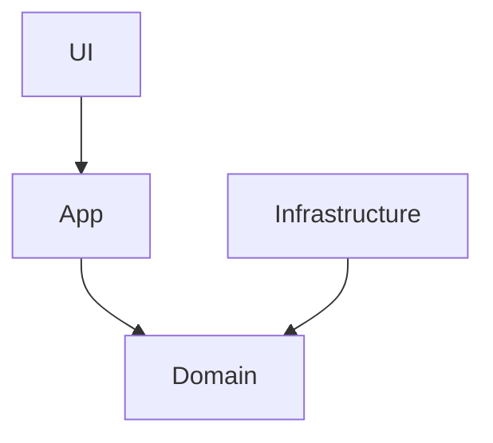

# C# Learn Bank

Учебная модель банковской системы. Предметная область учебного проекта подталкивает к плотному и правильному использованию ООП.
Существуют разные типы счетов с разным поведением, разные виды транзакций, правила, отчеты и так далее.
В такой задаче наследование, абстракции, полиморфизм, паттерны и многое другое используется естественно.

## Архитектура

- UI — CLI
- App — Сценарии (BankService)
- Infrastructure — Логгирование, время, хранилище, конфигурация и так далее
- Domain — Account, Transaction, Customer и другие

### Домены

Account (абстракция)
├── CreditAccount — кредитный счёт
└── DebitAccount — дебетовый  счёт
Transaction — запись операции
Customer — клиент
