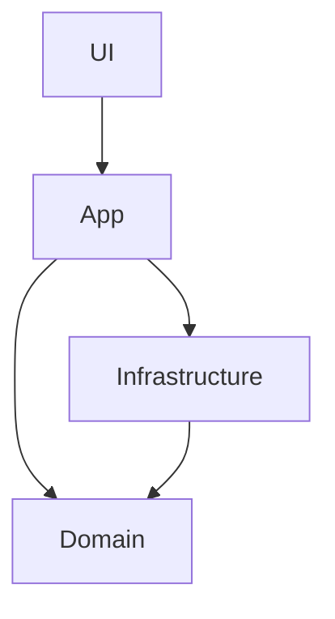
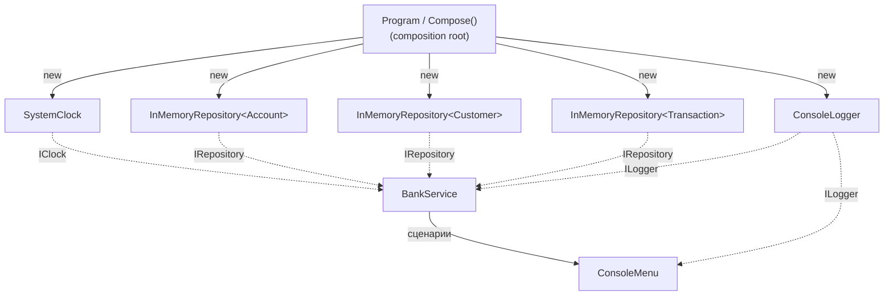
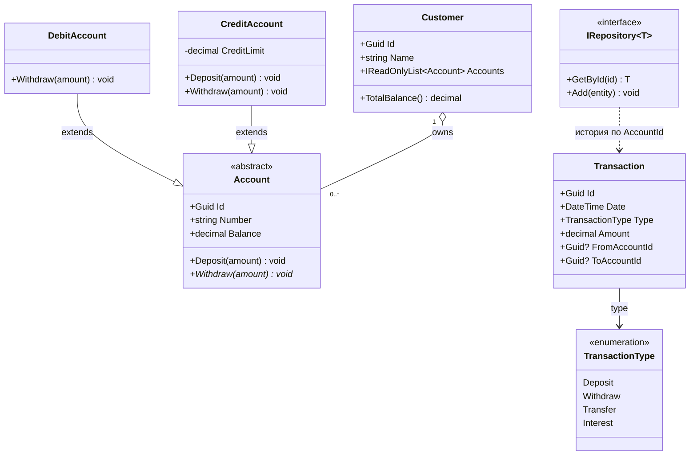
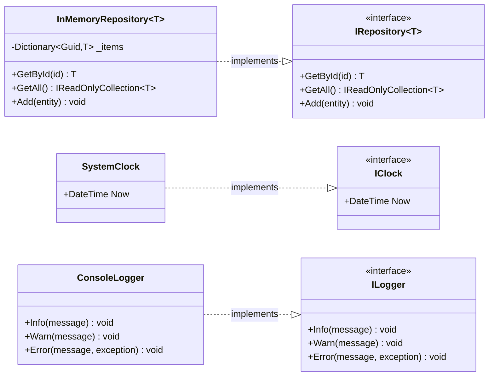
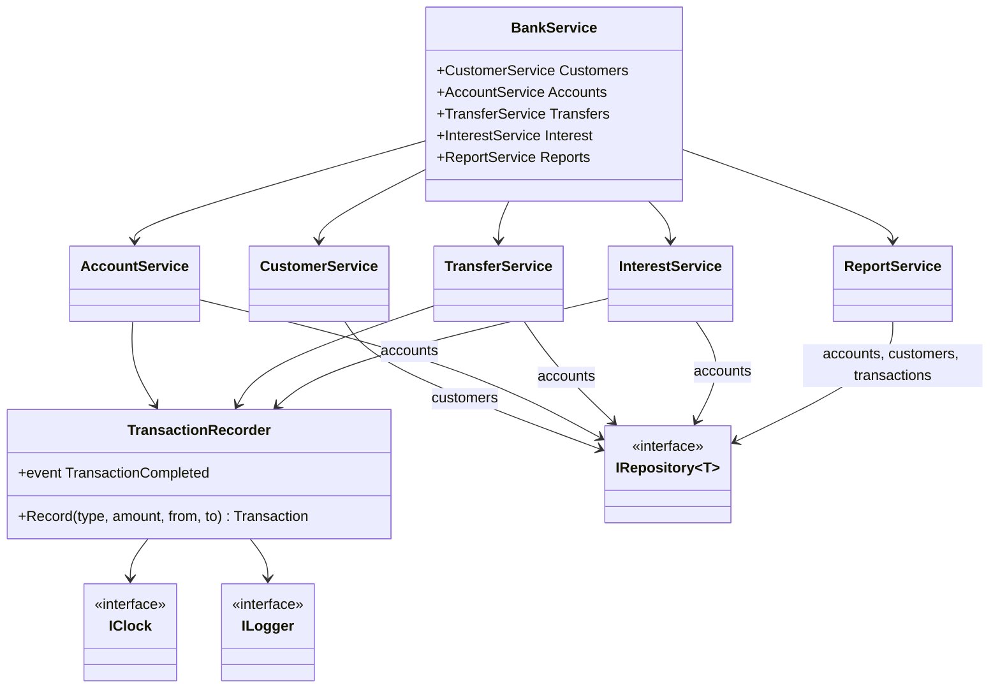

# C# Learn Bank

Учебная модель банковской системы. Предметная область учебного проекта подталкивает к плотному и правильному использованию ООП.
Существуют разные типы счетов с разным поведением, разные виды транзакций, правила, отчеты и так далее.
В такой задаче наследование, абстракции, полиморфизм, паттерны и многое другое используется естественно.

## Статус

Проект в начале разработки: создан скелет репозитория и зафиксирована архитектура, наполнение доменной модели законченно. API и структура слоёв ещё будут меняться.

## Стек и требования

- .NET SDK 10.0
- C#
- Форматирование: [CSharpier](https://csharpier.com/) (конфигурация в `.csharpierrc.json`)
- Тесты: фреймворк будет выбран при добавлении `Tests/`

## Архитектура



- **UI** — консольное меню и вывод. Вызывает только `BankService`.
- **App** — сценарии: переводы, проценты, отчёты (`BankService`).
- **Infrastructure** — логирование, время, генерация id и так далее.
- **Domain** — сущности и правила: `Account`, `Customer`, `Transaction` и другие.

## Поток выполнения

Единственная точка входа — `Program.Main` (composition root).

```text
Запуск процесса
  └─> Program.Main()
        ├─ создать ConsoleLogger (реализация ILogger)
        ├─ try:
        │    └─> Compose(logger)              // сборка графа зависимостей
        │          ├─ new SystemClock()                    : IClock
        │          ├─ new InMemoryRepository<Account>()     : IRepository<Account>
        │          ├─ new InMemoryRepository<Customer>()    : IRepository<Customer>
        │          ├─ new InMemoryRepository<Transaction>() : IRepository<Transaction>
        │          ├─ new TransactionRecorder(transactions, clock, logger)
        │          ├─ new BankService(customers, accounts, transfers, interest, reports)
        │          └─ new ConsoleMenu(service, logger)
        │    └─> menu.Run()                   // запуск UI
        │          └─> BankService.<сценарии>
        └─ catch (Exception ex):
              └─> logger.Error(...)           // централизованная обработка
Завершение процесса
```

Направление зависимостей строго внутрь: `UI → App → Domain`, `Infrastructure → Domain`.

### Composition root

Все зависимости внедряются через конструкторы.

```csharp
private static ConsoleMenu Compose(ILogger logger)
{
    IClock clock = new SystemClock();
    IRepository<Account> accounts = new InMemoryRepository<Account>();
    IRepository<Customer> customers = new InMemoryRepository<Customer>();
    IRepository<Transaction> transactions = new InMemoryRepository<Transaction>();

    var recorder = new TransactionRecorder(transactions, clock, logger);

    var service = new BankService(
        new CustomerService(customers),
        new AccountService(accounts, customers, recorder),
        new TransferService(accounts, recorder),
        new InterestService(accounts, recorder),
        new ReportService(accounts, customers, transactions)
    );
    return new ConsoleMenu(service, logger);
}
```

`Compose()` — единственное место, где конкретные классы инфраструктуры связываются с портами:



### Прикладной цикл

```text
меню → выбор команды → BankService.<под-фасад> → доменные сущности + репозиторий → результат в UI
```

Ошибки домена ловятся на уровне UI/App и показываются пользователю.

## Доменная модель



```text
Account (абстракция)
├── CreditAccount   кредитный счёт 
└── DebitAccount    дебетовый счёт
Transaction         запись операций
Customer            клиент
```

## Интерфейсы и расширяемость

- `IAccount` — единый контракт счёта.
- `IInterestBearing` — «умеет начислять проценты».
- `IRepository<T>` — абстракция хранения (JSON, память, БД, фейк в тестах).
- `ILogger`, `IClock` — точки расширения и тестируемости, чтобы не звать `DateTime` и `Console` напрямую.
- Событие `TransactionCompleted` — на него подписываются логирование и аудит; сервис не знает, кто реагирует.

### Infrastructure

Конкретные реализации портов. Каждая живёт в своей папке (`Persistence/`, `Time/`, `Logging/`, `Identity/`).



### Service (Application)

`BankService` — фасад прикладного слоя. Он не содержит бизнес-логики: агрегирует
под-фасады, каждый из которых отвечает за свой сценарий (деление по use case).

```text
BankService
├── Customers : CustomerService   регистрация и поиск клиентов
├── Accounts  : AccountService    открытие счетов, пополнение, снятие
├── Transfers : TransferService   переводы между счетами
├── Interest  : InterestService   начисление процентов
└── Reports   : ReportService     выписки и итоговые балансы
```

Под-фасады знают только порты (`IRepository<T>`, `IClock`, `ILogger`), а не их реализации.
Сквозная логика — запись `Transaction`, событие `TransactionCompleted` и логирование —
вынесена в общий коллаборатор `TransactionRecorder`, чтобы не дублировать её в каждом под-фасаде:



UI зависит только от `BankService`; конкретику подставляет composition root.

## Структура проекта

```text
C#-learn-bank/
├── src/
│   ├── Domain/             Account, Customer, Transaction, интерфейсы домена
│   ├── Application/        BankService-агрегатор, под-фасады (Customers, Accounts, Transfers, Interest, Reports)
│   ├── Infrastructure/     Persistence/, Logging/, Time/
│   └── UI/                 консольное меню
├── Tests/                  юнит-тесты (будет добавлен)
├── Program.cs              composition root, точка входа
├── C#-learn-bank.csproj
├── .csharpierrc.json
├── LICENCE
└── README.md
```

## Сборка и запуск

```bash
dotnet build
dotnet run
```

> Точка входа (`Program.Main` / composition root) реализуется в рамках инфраструктурного этапа
> вместе с `BankService` и консольным меню.

## Форматирование

```bash
dotnet tool install -g csharpier
csharpier format .
```

Настройки в `.csharpierrc.json`.

## Тестирование

Юнит-тесты — отдельный этап. Тестируемость заложена заранее: `IClock`, `ILogger` и `IRepository<T>`.
Запуск будет выглядеть как `dotnet test`.

## Лицензия

MIT. См. [LICENCE](LICENCE).
